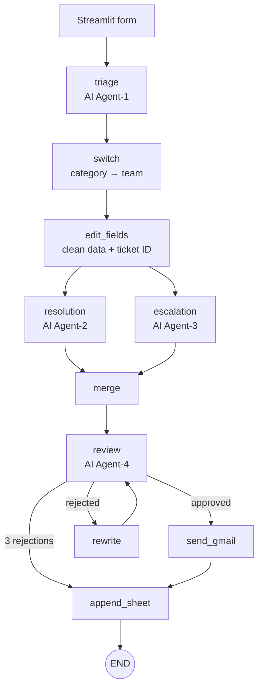

# 🛠️ IT Support Ticket Auto-Reply — Multi-Agent Workflow (LangGraph + Gemini)

A Python rebuild of an **n8n multi-step AI workflow**. A user submits an IT support ticket through a web form; four AI agents triage it, propose a fix, decide on escalation and review the reply using parallel and looped steps. The approved reply is emailed to the user and the ticket is logged in Google Sheets.

---

## ✨ Features

- **Web form** (Streamlit) to submit tickets
- **AI Agent-1 – Triage:** classifies category and priority using structured output
- **Switch:** routes the ticket to the right support team
- **AI Agent-2 – Resolution** and **AI Agent-3 – Escalation** run **in parallel**
- **Merge:** combines both results into one draft reply
- **AI Agent-4 – Review** checks the draft; if rejected, a **Rewrite** step improves it and sends it back for review (max 3 rounds)
- **Gmail:** sends the approved reply to the user
- **Google Sheets:** appends one row per ticket for the team to track

---

## 🧭 Architecture



### n8n → Python mapping

| n8n node | Python | File |
|---|---|---|
| On form submission | Streamlit form → `graph.invoke()` | `app.py` |
| AI Agent-1 – IT Support Triage Agent + Structured Output Parser | `triage` node, `with_structured_output(TriageResult)` | `triage.py` |
| Switch | `switch` node (category → team) | `workflow.py` |
| Edit Fields | `edit_fields` node | `workflow.py` |
| AI Agent-2 – Resolution Agent | `resolution` node | `agents.py` |
| AI Agent-3 – Escalation Agent | `escalation` node (structured output) | `agents.py` |
| Merge | Fan-in edge `["resolution", "escalation"] → merge` | `workflow.py` |
| AI Agent-4 – Review Agent | `review` node (structured output) | `agents.py` |
| If | Conditional edge `after_review()` | `workflow.py` |
| Basic LLM Chain | `rewrite` node, loops back to review | `agents.py` |
| Send a message (Gmail) | `send_gmail` node via SMTP | `gmail_sender.py` |
| Append row in sheet | `append_sheet` node via gspread | `sheets.py` |
| Google Gemini Chat Model | `ChatGoogleGenerativeAI` | `llm.py` |

---

## 🤖 The agents

| Agent | Role | Output | Key fields | Why this output type |
|---|---|---|---|---|
| **AI Agent-1** Triage | Help-desk receptionist — sorts the ticket | Structured | `category`, `priority`, `summary` | The Switch routes on `category`, so values must be exact |
| **AI Agent-2** Resolution | Level-1 engineer — writes self-help steps | Plain text | `resolution` | Read by a human, no fields to parse |
| **AI Agent-3** Escalation | Team lead — decides if a human engineer is needed | Structured | `escalate` (bool), `reason` | Code branches on `escalate` |
| **AI Agent-4** Review | Senior reviewer — quality gate before sending | Structured | `approved` (bool), `feedback` | Code branches on `approved` |
| Rewrite | Writer — fixes the draft using reviewer feedback | Plain text | `final_reply` | Read by a human |

- **Triage** uses `Literal[...]` types so Gemini can only return allowed values (e.g. `Hardware`, never `hardware`).
- **Resolution** and **Escalation** don't depend on each other, so they run **in parallel**; each writes to its own State key.
- **Review** rejects only real problems (wrong, unsafe or off-topic replies), not style. After 3 rejections the ticket is logged as *Needs Human* and no email is sent.

---

## 🔗 How LangGraph and LangChain work together

**LangGraph decides _what runs and when_. LangChain handles _talking to Gemini_.**

| Library | Responsible for | Used in |
|---|---|---|
| **LangGraph** | State, nodes, edges, parallel fan-out, fan-in (merge), conditional edges (If), the review loop, `compile()` / `invoke()` | All 10 nodes (`workflow.py`, `state.py`) |
| **LangChain** | Gemini model wrapper, `SystemMessage` / `HumanMessage`, `invoke()`, `with_structured_output()` | The 5 AI nodes: triage, resolution, escalation, review, rewrite |
| Plain Python | Form, email, sheet | `streamlit`, `smtplib`, `gspread` |

Inside one node, both work together:

```python
triage_llm = get_llm().with_structured_output(TriageResult)    # LangChain

def triage(state: TicketState) -> dict:                         # LangGraph calls the node with the State
    result = triage_llm.invoke([SystemMessage(TRIAGE_PROMPT),   # LangChain talks to Gemini
                                HumanMessage(ticket_text)])
    return result.model_dump()                                  # LangGraph merges this into the State
```

**Why LangGraph (not plain LangChain):** this workflow needs **parallel branches**, a **merge** that waits for both, an **If** with three paths and a **loop** with a limit. LangGraph supports all of these natively; LangChain alone only chains steps in a straight line.

---

## 📁 Project structure

```
ticket_workflow/
├── app.py            # Streamlit form (entry point)
├── workflow.py       # LangGraph graph: nodes + wiring
├── state.py          # TicketState — shared data passed between nodes
├── llm.py            # Gemini model setup
├── triage.py         # AI Agent-1 Triage (structured output)
├── agents.py         # AI Agent-2 Resolution, AI Agent-3 Escalation, AI Agent-4 Review, Rewrite
├── gmail_sender.py   # Send email via Gmail SMTP
├── sheets.py         # Append rows to Google Sheets
├── requirements.txt
├── .env.example      # Template for required settings
└── README.md
```

---

## ⚙️ Setup

### 1. Prerequisites
- Python 3.10+
- A Google account

### 2. Install
```bash
python -m venv venv
venv\Scripts\activate          # Windows
# source venv/bin/activate     # macOS / Linux
pip install -r requirements.txt
```

### 3. Gemini API key
Create a free key at **Google AI Studio** (aistudio.google.com) → *Get API key*.
Use the **model ID** (lowercase, with hyphens), e.g. `gemini-3.5-flash-lite`, not the display name.

### 4. Gmail App Password
1. Turn on **2-Step Verification** for the Google account.
2. Create an App Password at **myaccount.google.com/apppasswords**.
3. Use the 16-character password **without spaces**. A normal Gmail password will not work.

### 5. Google Sheets (service account)
1. In **console.cloud.google.com**, select a project and enable the **Google Sheets API**.
2. *IAM & Admin → Service Accounts → Create* (no role needed).
3. Open the account → *Keys → Add key → JSON*. Save it as `service_account.json` in the project folder.
4. Create a blank Google Sheet and **share it as Editor** with the `client_email` from the JSON file.
5. Copy the sheet ID from the URL: `https://docs.google.com/spreadsheets/d/<SHEET_ID>/edit`.

### 6. Configure `.env`
Copy `.env.example` to `.env` and fill in the values:
```
GOOGLE_API_KEY=your_gemini_api_key
GEMINI_MODEL=gemini-3.5-flash-lite
GMAIL_ADDRESS=your_email@gmail.com
GMAIL_APP_PASSWORD=your_16_char_app_password
GOOGLE_SHEET_ID=your_google_sheet_id
GOOGLE_SA_FILE=service_account.json
```
> ⚠️ Never commit `.env` or `service_account.json`.

---

## ▶️ Run

**Web form:**
```bash
streamlit run app.py
```
Open http://localhost:8501, fill in the form and submit.

**Terminal test (one sample ticket):**
Edit the email in the `if __name__ == "__main__":` block of `workflow.py`, then:
```bash
python workflow.py
```

### Example terminal output
```
1. triage -> Hardware / High
2. switch -> Desktop Team
3. edit_fields -> TKT-20261126-095406
4a. resolution -> done
4b. escalation -> escalate=True
5. merge
6. review #1 -> approved=True | OK
8. send_gmail -> sent to user@example.com
9. append_sheet -> row added
```

---

## 🧠 Key concepts used

| Concept | Where |
|---|---|
| **State** — one shared `TypedDict`; each node returns only the keys it changes | `state.py` |
| **Structured output** — Pydantic model + `Literal` forces exact values from the LLM | `triage.py`, `agents.py` |
| **Parallel fan-out** — two edges from one node run both nodes at once | `edit_fields → resolution / escalation` |
| **Fan-in** — `add_edge([...], "merge")` waits for both branches | `workflow.py` |
| **Conditional edge + loop** — review routes to send, rewrite or give up | `after_review()` |
| **Loop guard** — `MAX_REVIEWS = 3` stops endless rewrite cycles | `workflow.py` |
| **Graceful failure** — Gmail/Sheets errors are caught, so the graph never crashes and the ticket is still logged | `send_gmail`, `append_sheet` |
